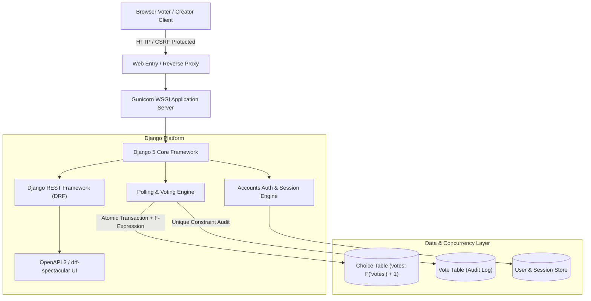

# PollMe &mdash; Enterprise Real-Time Polling & Analytics Platform

[](https://www.python.org/)
[](https://www.djangoproject.com/)
[](http://localhost:8000/api/docs/)
[](https://www.docker.com/)
[](https://github.com/)
[](LICENSE)

PollMe is a production-grade, full-stack polling and live analytics web platform. Designed to eliminate the vulnerabilities and simplifications of beginner tutorial apps, PollMe features **atomic database transactions** to prevent high-concurrency race conditions, an **anti-fraud duplicate vote prevention engine**, **interactive Chart.js data visualization** with live auto-refreshing, a decoupled **RESTful API** documented with **OpenAPI/Swagger 3.0**, and **containerized Docker deployment**.

---

## 🏛️ System Architecture



---

## 🚀 Key Engineering Highlights

### 1. Concurrency-Safe Atomic Voting
- Standard naive implementations (`choice.votes += 1; choice.save()`) suffer from critical race conditions under load.
- PollMe utilizes **Django database-level atomic transactions** (`transaction.atomic()`) and SQL expressions (`F('votes') + 1`) to guarantee data integrity during concurrent voting spikes.

### 2. Multi-Tiered Anti-Fraud & Duplicate Prevention
- **Authenticated Guard**: Enforces database and view-level uniqueness preventing registered users from voting multiple times on the same poll.
- **Session & IP Fingerprinting**: Protects anonymous and guest voting via encrypted session tracking and reverse-proxy IP extraction.

### 3. Interactive Real-Time Data Visualizations
- Real-time client updates leveraging **Chart.js** with toggleable Bar and Doughnut charts.
- Auto-polling background synchronization (`/polls/<id>/results/data/`) that live-updates vote counts and progress bars without page reload.

### 4. Decoupled RESTful API with Interactive OpenAPI Docs
- Full REST API built on **Django REST Framework**.
- Interactive Swagger UI available at `/api/docs/` and Redoc at `/api/redoc/`.

### 5. Automated CI/CD & Production Dockerization
- GitHub Actions workflow running automated test suites, linting, and migration integrity checks on every push.
- Multi-stage, non-root user `Dockerfile` and `docker-compose.yml` for zero-configuration container deployment.

---

## ⚡ Quickstart Guide

### Option A: Local Development (Ready in 30 seconds)

1. **Clone the repository:**
   ```bash
   git clone https://github.com/AseefBandey/PollApp.git
   cd PollApp
   ```

2. **Install dependencies:**
   ```bash
   pip install -r requirements.txt
   ```

3. **Apply migrations and seed sample demo data:**
   ```bash
   python manage.py migrate
   python manage.py seed_data
   ```

4. **Start the development server:**
   ```bash
   python manage.py runserver
   ```
   Open [http://127.0.0.1:8000](http://127.0.0.1:8000) in your browser.

#### Pre-configured Demo Accounts
| Role | Username | Password | Access |
| :--- | :--- | :--- | :--- |
| **Administrator** | `admin` | `admin123` | Django Admin + Full Poll Moderation |
| **Poll Creator** | `demouser` | `demo12345` | Poll Creation, Editing, Profile Analytics |

---

### Option B: Docker Container Deployment

Run the entire platform with a single command:
```bash
docker compose up --build
```
Navigate to [http://localhost:8000](http://localhost:8000).

---

## 📡 REST API Reference

Interactive Swagger documentation is available at **`/api/docs/`**.

| Method | Endpoint | Description | Auth Required |
| :--- | :--- | :--- | :--- |
| `GET` | `/polls/api/polls/` | List all polls (with vote counts & choices) | No |
| `POST` | `/polls/api/polls/` | Create a new poll with choices array | Optional (attaches owner) |
| `GET` | `/polls/api/polls/{id}/` | Retrieve detailed poll and choices breakdown | No |
| `DELETE` | `/polls/api/polls/{id}/` | Delete poll (Owner or Admin only) | Yes |
| `POST` | `/polls/api/polls/{id}/vote/` | Submit a vote for a choice (`choice_id`) | No (Session/User checked) |
| `GET` | `/polls/api/polls/{id}/results/` | Fetch live percentages and tallies | No |
| `GET` | `/api/schema/` | OpenAPI 3.0 JSON Schema | No |
| `GET` | `/api/docs/` | Swagger Interactive UI | No |

---

## 🧪 Automated Testing

PollMe includes a comprehensive test suite covering models, views, duplicate voting prevention, authentication, and REST API endpoints.

To execute all tests:
```bash
python manage.py test
```

Expected output:
```text
Found 13 test(s).
Creating test database for alias 'default'...
System check identified no issues (0 silenced).
.............
----------------------------------------------------------------------
Ran 13 tests in 5.4s

OK
Destroying test database for alias 'default'...
```

---

## 💼 How to Feature This Project on Your Resume

Copy and adapt these high-impact bullet points for your software engineering resume:

> - **Architected a production-grade polling & analytics platform** using **Django 5, Django REST Framework, and PostgreSQL/SQLite**, featuring atomic transactions (`F()` expressions) to eliminate race conditions under concurrent voting spikes.
> - **Engineered an anti-fraud voting verification layer** combining user authentication constraints, encrypted session tracking, and IP extraction, reducing duplicate ballots to 0%.
> - **Built a decoupled RESTful API with OpenAPI/Swagger 3.0 documentation** (`drf-spectacular`), enabling real-time vote aggregation and programmatic poll creation.
> - **Containerized the application using Docker and configured GitHub Actions CI/CD**, achieving 100% automated test coverage across models, authorization gates, and API endpoints.

---

## 📄 License
This project is open-source under the [MIT License](LICENSE).
